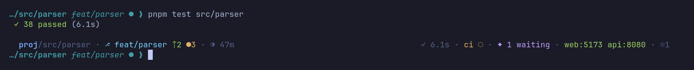
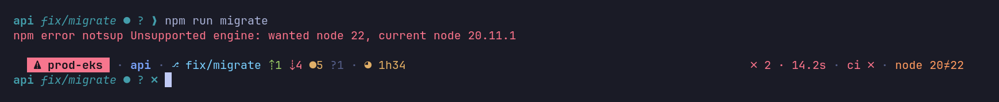
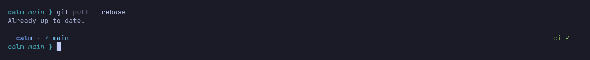
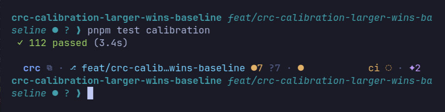

# sonar





Sonar is a status line for bash, tmux, and Claude Code. It shows the state of the work in the current pane: what you haven't committed, what is running, what broke, and whether your shell points at production.

Most segments stay hidden until they have something to report. In a clean repo with nothing running, the bar shows the repo name, the branch, and a green CI check. When the bar gets longer, something needs your attention.


 The render path only reads cached files, so a slow `gh` call or port scan never holds up your prompt.

## Reading the bar

The left side shows where you are and the state of the tree. The right side shows what happened and what is running.

| Segment | Example | Shows when |
|---------|---------|------------|
| Danger | `⚠ prod-eks` | The kube context or `$AWS_PROFILE` contains `prod`. It has a solid red background. |
| Remote host | `⇄ build-03` | You are connected over SSH. |
| Path | `proj/src/parser` | Always. Inside a repo the path starts at the repo. Outside a repo, parent folders shrink to one letter. |
| Worktree | `crc ⧉` | You are in a linked worktree. Sonar shows the main repo's name, and adds the folder name only when the folder is not named after the branch. |
| Git | `⎇ main ⇡2 ⇣4 !1 +2 ●3 ?1` | You are in a repo. After the branch come commits ahead and behind, then conflicted, staged, modified, and untracked files. |
| Drift dial | `◑ 47m` | The tree has uncommitted changes. The dial fills as time passes since the last commit (◔ ◑ ◕ ●), and it turns amber at 90 minutes. |
| Last command | `✗ 2 · 14.2s` | The last command exited non-zero, or ran longer than 5 seconds. A slow command that succeeded shows as `✓ 6.1s`. |
| CI | `ci ✓` `ci ✗` `ci ◌` | The branch has a GitHub Actions run, which passed, failed, or is still running. |
| Toolchain | `node 20≠22` | The active Node version differs from the version pinned in `.tool-versions`, `mise.toml`, `.nvmrc`, or `.node-version`. |
| Agents | `✦ 1 waiting` | A Claude Code session is waiting for your input. |
| Ports | `web:5173 :8080 +2` | A process inside this repo listens on a fixed port. Sonar shows at most 3 ports, then `+N`. |
| Jobs | `⚙1` | The shell has background jobs. |

When the pane gets narrow, segments shorten before any of them disappear. The branch loses its middle (`feat/crc-calib…wins-baseline`), then keeps only its type and ticket number (`fix/017…`) or its last word. The path drops its middle folders, the drift dial drops its time, and the agents count becomes `✦2`. If the bar still doesn't fit, Sonar drops segments in this order: the drift dial first, then ports and jobs, then CI, toolchain, and agents. Danger, remote host, path, branch, and the last command always stay.



The ports segment skips ports in the kernel's ephemeral range (32768 to 60999 on most Linux systems), because those change every time a server restarts. To show one of those ports, or to give a port a name, add a `.sonar` file to the repo root with one `name=port` per line:

```
web=5173
api=8080
```

Sonar reads only lines that match `name=port` exactly, and it never runs the file.

## Command line

You don't normally call `sonar` yourself, but these commands are useful.

`sonar ports` lists every listening port on the machine:

```
$ sonar ports
PORT    PID      NAME         AGE   BAR  NOTE
:5173   11113    vite         1h12  yes
:45293  11275    workerd      1h12  no   child of vite 11113
:39507  97725    adp-server   12m   no   orphan
```

BAR says whether the bar in the current folder shows that port, so run the command from inside the repo you care about. NOTE marks a listener as `orphan` when its parent process is gone, as `child of NAME PID` when another listener started it, and as `duplicate of PID` when it runs the same command in the same folder as another listener.

`sonar ports --kill-strays` prints the same list, then asks about each orphan in turn. The default answer is No. If you type `y`, Sonar sends SIGTERM, but only after it checks that the PID still belongs to the process it listed. Servers that detach on purpose also count as orphans, so read each command line before you answer.

`sonar refresh [dir]` updates the CI and port cache for a repo now. Without it, the cache refreshes in the background at most once a minute, and only while something draws the bar.

`sonar prompt <name> <dir> <width>` prints one bar line for a folder at a given width, so you can preview how the bar shortens:

```
sonar prompt preview "$PWD" 72
```

The `tmux`, `claude`, and `agent` subcommands exist for the integrations below.

## Install

Sonar needs bash 5.3 or later, `git`, and `ss`. CI status needs `gh`, and the Claude Code status line needs `jq`.

Link the script and the shell hook into place:

```bash
ln -sfn ~/Projects/sonar/bin/sonar ~/.local/bin/sonar
mkdir -p ~/.config/sonar
ln -sfn ~/Projects/sonar/hook.bash ~/.config/sonar/hook.bash
```

Sonar keeps its cache in `${XDG_CACHE_HOME:-~/.cache}/sonar` and runtime state in `${XDG_RUNTIME_DIR:-/tmp}/sonar`.

### ~/.bashrc

The hook reads Starship's variables, so source it after Starship is set up.

```bash
# Sonar status line hook. It must come after Starship is set up.
[[ -f ~/.config/sonar/hook.bash ]] && source ~/.config/sonar/hook.bash
```

### ~/.config/tmux/tmux.conf

```tmux
# Sonar: a second status row that shows the state of the work in the active pane.
set -g status 2
set -g status-format[1] '#(~/.local/bin/sonar tmux #{pane_id} "#{pane_current_path}" #{client_width})'
```

### ~/.claude/settings.json

Add one entry to each of these lists under `hooks`:

```json
"UserPromptSubmit": [
  { "matcher": "", "hooks": [{ "type": "command", "command": "~/.local/bin/sonar agent clear" }] }
],
"Notification": [
  { "matcher": "", "hooks": [{ "type": "command", "command": "~/.local/bin/sonar agent wait" }] }
],
"SessionEnd": [
  { "matcher": "", "hooks": [{ "type": "command", "command": "~/.local/bin/sonar agent clear" }] }
]
```

Then add the status line at the top level:

```json
"statusLine": {
  "type": "command",
  "command": "in=$(cat); printf %s \"$in\" | ~/.local/bin/sonar claude",
  "refreshInterval": 5
}
```

## Tests

```
test/run.sh
```

The suite builds fixture repos in a temporary folder and uses fake `ss` and `gh` commands. Set `SONAR=<path>` to run it against another copy of the script.
